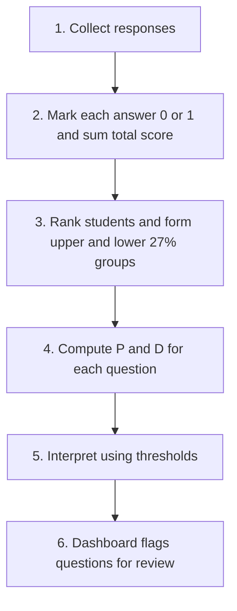

# Specialized Technology: Learning Analytics with Classical Test Theory

**Chosen technology:** Learning analytics using Classical Test Theory (CTT) item analysis, with data visualization (Assignment 1 option 6: Other).

## 1. Concepts 

### What it is
Learning analytics is the collection and analysis of data about learners in order to understand and improve learning (Kaliisa et al., 2023). In this project the data are students' answers to multiple-choice questions (MCQs). The analysis method is **Classical Test Theory (CTT)**, which treats a student's observed score as a "true" level of knowledge plus random error (Crocker & Algina, 1986). From the pattern of correct and wrong answers across a class, CTT produces statistics for each question. This is called **item analysis**.

### Key concepts
- **Difficulty Index (P):** the proportion of students who answered the question correctly. `P = R / N`, where R is the number of correct answers and N is the number of students. A high P means an easy question.
- **Discrimination Index (D):** how well a question separates strong students from weak students. `D = (U − L) / g`, where U and L are the numbers of correct answers in the upper and lower groups, and g is the size of each group. The groups are normally the top and bottom 27% of students by total score (Rezigalla et al., 2024). D runs from −1 to +1. A negative D means weaker students did better than stronger ones, which often points to a wrong answer key (Kehoe, 1995).
- **Thresholds:** Rezigalla et al. (2024) classify P of 26–75% as acceptable (0–25% difficult, 76–100% easy) and D of 0.35 or more as excellent. Cut-offs differ between studies, so the system will let lecturers change them.
- **Dashboard:** charts and tables that show the results so the lecturer can see which questions to review.

### How it works

### Worked example
10 students answered 6 questions (1 = correct, 0 = wrong). 27% of 10 students is 2.7, so each group has g = 3 students. The data are invented for teaching purposes.

| Student | Q1 | Q2 | Q3 | Q4 | Q5 | Q6 | Total | Group |
|---|---|---|---|---|---|---|---|---|
| S1  | 1 | 1 | 1 | 0 | 1 | 1 | 5 | Upper |
| S2  | 1 | 1 | 1 | 0 | 1 | 1 | 5 | Upper |
| S3  | 1 | 1 | 1 | 0 | 1 | 0 | 4 | Upper |
| S4  | 1 | 0 | 1 | 1 | 0 | 0 | 3 | Middle |
| S5  | 1 | 0 | 0 | 1 | 1 | 0 | 3 | Middle |
| S6  | 0 | 0 | 1 | 1 | 1 | 0 | 3 | Middle |
| S7  | 1 | 0 | 0 | 1 | 1 | 0 | 3 | Middle |
| S8  | 0 | 0 | 0 | 1 | 1 | 0 | 2 | Lower |
| S9  | 0 | 0 | 0 | 1 | 0 | 0 | 1 | Lower |
| S10 | 0 | 0 | 0 | 0 | 1 | 0 | 1 | Lower |

| Item | R | P | U | L | D | Reading and action |
|---|---|---|---|---|---|---|
| Q1 | 6 | 0.60 | 3 | 0 | 1.00 | Acceptable P, excellent D. Keep. |
| Q2 | 3 | 0.30 | 3 | 0 | 1.00 | Fairly hard but excellent D. Keep. |
| Q3 | 5 | 0.50 | 3 | 0 | 1.00 | Acceptable P, excellent D. Keep. |
| Q4 | 6 | 0.60 | 0 | 2 | −0.67 | Negative D. Check the answer key. |
| Q5 | 8 | 0.80 | 3 | 2 | 0.33 | Easy (P above 0.75), D only 0.33. Review. |
| Q6 | 2 | 0.20 | 2 | 0 | 0.67 | Difficult (P below 0.26). Check topic coverage. |

For Q4: six students answered correctly, so P = 6 / 10 = 0.60. None of the upper group (U = 0) but two of the lower group (L = 2) were correct, so D = (0 − 2) / 3 = −0.67. Weaker students beat stronger ones, so the lecturer should check the answer key.

## 2. Frameworks, methods and tools 

| Name | Type | What it is used for |
|---|---|---|
| Classical Test Theory | Framework | Models observed score as true score plus error and supports item-level statistics (Crocker & Algina, 1986). The core framework of the project. |
| Upper–lower group method | Method | Ranks students by total score and compares the top and bottom 27% to get the Discrimination Index (Rezigalla et al., 2024). |
| KR-20 reliability | Statistic | Estimates how consistent a whole MCQ test is. It would be a test-level indicator beside the item statistics. |
| Distractor analysis | Method | Counts how often each wrong option is chosen; options chosen by under 5% of students are non-functional (Rezigalla et al., 2024). A possible later extension. |
| pandas (Python) | Tool | Holds the response matrix and computes totals, P and D. Useful to check the system's results independently (McKinney, 2010). |
| Matplotlib (Python) | Tool | Draws charts such as P against D (Hunter, 2007). A web chart library would do the same job in the dashboard. |

## 3. Fit to my problem 

### How it addresses the problem
- Item analysis replaces guesswork about question quality with two numbers per question (FR6, FR7).
- The dashboard turns the numbers into a chart and a short flagged list, so lecturers get question-level insight instead of only scores (FR8, FR9; Kaliisa et al., 2023).
- Automatic marking and calculation remove repeated manual work (FR5).

### Benefits
- Simple and transparent: a lecturer can see how every number was obtained.
- Needs only the response data that an online quiz already produces.
- Works with the small class sizes common in one course.
- Cheap to build and run.

### Limitations and risks
1. **Small and unrepresentative samples.** CTT statistics depend on the group tested, and a class of 20 gives unstable indices. A flagged question is a prompt for review, not proof of a bad question.
2. **Statistics cannot confirm the answer key.** A negative D suggests a problem, but the lecturer must verify it. The system flags questions and never deletes them.
3. **Privacy and ethics.** Student responses are sensitive. Kaliisa et al. (2023) found that only one of 50 dashboard studies treated privacy as a design requirement. The system limits access by role (FR10, NFR3) and uses simulated data for testing.
4. **Scope.** CTT as used here covers objective MCQs only, and cut-off values vary between studies.

### Alternative and choice
The main alternative is **Item Response Theory (IRT)**, which models the probability of a correct answer from a student's ability and item parameters such as difficulty and discrimination (Crocker & Algina, 1986). However, IRT usually needs larger samples and specialised software, and its outputs are harder for lecturers to read. I chose **CTT** because the project targets ordinary course-level quizzes, needs results that lecturers can understand and verify, and must be finished in one project cycle. IRT can be future work if larger datasets become available.

## Sources
1. Crocker, L., & Algina, J. (1986). *Introduction to classical and modern test theory*. Holt, Rinehart and Winston.
2. Hunter, J. D. (2007). Matplotlib: A 2D graphics environment. *Computing in Science & Engineering, 9*(3), 90–95. https://doi.org/10.1109/MCSE.2007.55
3. Kaliisa, R., Jivet, I., & Prinsloo, P. (2023). A checklist to guide the planning, designing, implementation, and evaluation of learning analytics dashboards. *International Journal of Educational Technology in Higher Education, 20*, Article 28. https://doi.org/10.1186/s41239-023-00394-6
4. Kehoe, J. (1995). Basic item analysis for multiple-choice tests. *Practical Assessment, Research, and Evaluation, 4*(10). https://doi.org/10.7275/07zg-h235
5. McKinney, W. (2010). Data structures for statistical computing in Python. In S. van der Walt & J. Millman (Eds.), *Proceedings of the 9th Python in Science Conference* (pp. 56–61). https://doi.org/10.25080/Majora-92bf1922-00a
6. Rezigalla, A. A., Eleragi, A. M. E. S. A., Elhussein, A. B., Alfaifi, J., ALGhamdi, M. A., Al Ameer, A. Y., Yahia, A. I. O., Mohammed, O. A., & Adam, M. I. E. (2024). Item analysis: The impact of distractor efficiency on the difficulty index and discrimination power of multiple-choice items. *BMC Medical Education, 24*, Article 445. https://doi.org/10.1186/s12909-024-05433-y